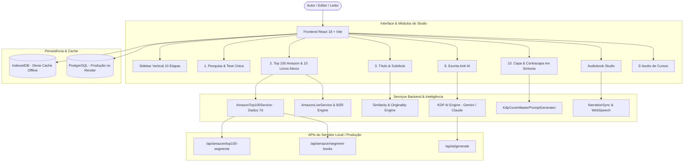
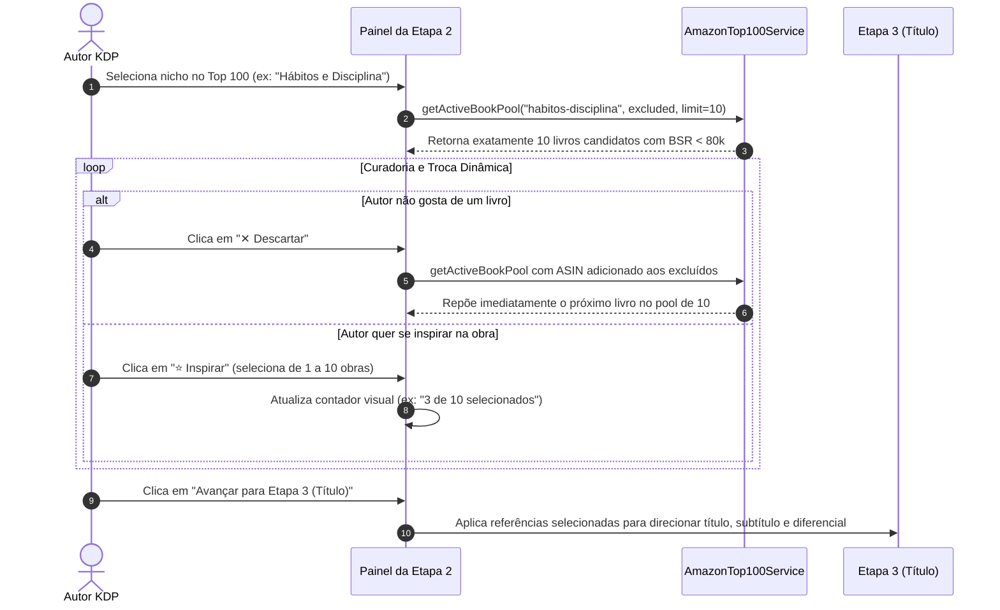

# 📚 BookEngin • Plataforma Editorial com IA, Bestseller Engine & Inteligência Amazon

> **A plataforma definitiva para pesquisa de mercado em tempo real, inteligência de buscas na Amazon (últimos 7 dias), esteira editorial guiada de 10 etapas, escrita anti-alucinação, capas em sintonia visual, estúdio de audiobooks e publicação profissional no Amazon KDP.**

[](https://book-intel-kdp.onrender.com/)
[](https://react.dev/)
[](https://vitejs.dev/)
[](https://replicate.com/)
[](https://amazon.com.br)
[](https://vitest.dev/)

---

## 🌟 Visão Geral do Produto

O **BookEngin** é uma solução completa de engenharia editorial e inteligência de mercado projetada para autores independentes, editoras digitais e criadores de infoprodutos. Ele substitui ferramentas fragmentadas por uma **esteira editorial guiada de 10 etapas verticais**, integrando pesquisas de clientes na Amazon, seleção dinâmica de referências, escrita densa sem clichês de IA e diagramação oficial para impressão e e-book.

A plataforma opera simultaneamente como:
1. **Esteira Editorial Bestseller (10 Etapas):** fluxo guiado da concepção da tese única até o PDF pronto com capa e contracapa em sintonia visual total.
2. **Top 100 Segmentos & Buscas dos Clientes Amazon (7 Dias):** monitoramento em tempo real de termos digitados por compradores na barra de busca, volume semanal, velocidade de crescimento e seleção dinâmica de 1 a 10 livros de referência com substituição instantânea.
3. **Estúdio de Audiobooks & Narração Sincronizada:** engine vocal neural com leitura em tempo real por parágrafos, controle de ritmo e player de áudio integrado.
4. **Estúdio de E-books de Cursos Didáticos:** estruturação pedagógica passo a passo com comparativos de "Antes e Depois" e leitor digital compartilhável sem necessidade de login.
5. **Estúdio de Romance Cinematográfico:** motor de narrativa fotográfica 35mm f/1.4 com bíblia de personagens e consistência visual rigorosa.
6. **Extensão Chromium (Manifest V3):** inteligência de mercado integrada às 22 lojas globais da Amazon com estimativas precisas de BSR, vendas mensais e royalties líquidos.

---

## 🚀 Principais Módulos & Recursos

### 1. 🔍 Top 100 Segmentos Amazon & Inteligência de Buscas (Últimos 7 Dias)
O motor de validação de mercado mais avançado para autores que desejam ranquear entre os mais vendidos (BSR < 80.000):

* **Catálogo dos 100 Segmentos Mais Buscados:** Ranking numerado (#1 a #100) calibrado com dados reais de comportamento de compra dos últimos 7 dias na Amazon Brasil e global.
* **Métricas Reais de Demanda:**
  * Volume de buscas semanais dos compradores (ex: `248.900 buscas/semana`);
  * Velocidade e tendência de crescimento em 7 dias (ex: `+46% em 7 dias`);
  * BSR médio do segmento garantido em faixa competitiva lucrativa (`BSR < 80.000`);
  * Termos de pesquisa exatos digitados na barra da Amazon (`"habitos atomicos"`, `"investimentos para iniciantes"`, etc.);
  * Gancho psicológico dominante identificado pela IA.
* **Pool de 10 Livros Ativos por Segmento:**
  * Exibe exatamente **10 livros candidatos** simultaneamente para o autor analisar;
  * Cada cartão contém capa oficial em alta resolução da CDN da Amazon, título, subtítulo, autor, BSR, estimativa de vendas/mês, faturamento mensal, nota de avaliação e número de reviews;
  * **Substituição Dinâmica Instantânea:** ao clicar em `✕ Descartar`, o livro é removido e o sistema puxa **automaticamente o próximo livro do pool**, mantendo sempre 10 opções ativas na tela;
  * **Curadoria Livre de 1 a 10 Livros de Inspiração:** o autor pode marcar entre 1 e 10 obras clicando em `⭐ Inspirar` com feedback visual imediato (`X de 10 selecionados`).
* **Endpoints REST Dedicados:**
  * `GET /api/amazon/top100-segments` — listagem completa dos 100 nichos com filtros de categoria e busca textual;
  * `GET /api/amazon/segment-books?segmentId=...&excluded=...&limit=10` — pool dinâmico com exclusão de descartados.

---

### 2. 🎯 Motor de Sugestão Contextualizada de Títulos & Subtítulos (BSR < 80.000)
Gera automaticamente títulos e subtítulos de altíssimo apelo comercial calibrados com precisão por nicho e pelos bestsellers concorrentes:
* **Adequação Total de Gênero:** Diferenciação estrita entre Ficção/Thriller (*A Esposa Perfeita*, *O Segredo do Chalé 7*), Hábitos (*Micro-Hábitos de Aço*, *Disciplina sem Esforço*), Finanças (*A Máquina de Liberdade Financeira*) e Romance (*Contrato com o Inimigo*), eliminando qualquer fórmula genérica pré-fabricada.
* **Desconstrução Estrutural de Bestsellers Concorrentes:** Ao selecionar ou inspirar uma obra em um concorrente (ex: *Garota Exemplar*), o motor desestrutura a premissa e gera títulos de suspense autênticos com ganchos de alta retenção no Kindle Unlimited.
* **1-Clique para Aplicar & Avançar:** Cada recomendação e cada livro de referência oferece botões dedicados de `[Usar Título]` e `[Avançar para Próxima Etapa →]`, integrando a seleção de ideias diretamente ao fluxo vertical da esteira editorial.
* **Endpoints REST:**
  * `GET /api/kdp/suggest-titles?theme=...&subtheme=...` — sugestões completas com gancho psicológico, estimativa de BSR e justificativa comercial;
  * `GET /api/amazon/suggest-titles?theme=...&bookTitle=...` — desconstrução e títulos inspirados em obra de referência.

---

### 3. ⚡ Esteira Editorial Vertical Guiada (10 Etapas Anti-IA)
Layout limpo em duas colunas (barra lateral de navegação vertical de 260px + espaço de trabalho amplo com foco na obra), estruturado nos padrões da indústria:

```
[Etapa 01] Pesquisa, Tema Central & Tese Única (Stance Forte)
[Etapa 02] Análise do Top 100 Amazon & Curadoria de Referências
[Etapa 03] Título, Subtítulo Comercial & Teste de Similaridade
[Etapa 04] Recursos, Fontes & Base de Conhecimento (Links e Notas)
[Etapa 05] Persona, Voz & Biografia do Autor (Pseudônimo / Pessoal)
[Etapa 06] Proposta de Valor, Diferencial Competitivo & Tags USP
[Etapa 07] Estrutura & Sumário com Ritmo Variado (Sem Capítulos Robóticos)
[Etapa 08] Escrita de Alta Densidade com Estudos de Caso e Dados Reais
[Etapa 09] Descrição Comercial Persuasiva & Sinopse de Conversão KDP
[Etapa 10] Capa, Lombada Paramétrica & Contracapa em Sintonia Total
```

* **Anti-Alucinação & Originalidade:** o sistema analisa livros concorrentes exclusivamente para extrair padrões estruturais e lacunas de mercado. Nenhuma linha é plagiada.
* **Sumário com Ritmo Variado:** quebra a fórmula previsível de IA generativa tradicional (onde todo capítulo tem introdução, 3 tópicos e conclusão) alternando capítulos densos, estudos de caso, micro-exercícios de 15 minutos e checklists executáveis.
* **Acabamento Gráfico de Miolo (Silhueta & Marca d'Água P&B):** suporte opcional a ilustrações monocromáticas sutis ao fundo das páginas para livros impressos de luxo.

---

### 3. 🎙️ Estúdio de Audiobooks & Vídeo Stories TikTok
* **Audiobook Studio Integrado:**
  * Motor de síntese vocal com vozes femininas e masculinas moduladas;
  * Sincronização em tempo real com destaque do parágrafo em leitura;
  * Reprodução contínua da obra inteira ou audição por capítulo individual;
  * Player flutuante com controle de volume, pausa e avanço.
* **KdpTikTokStoryStudio:**
  * Gerador de roteiros visuais verticais (9:16) para divulgação no TikTok, Instagram Reels e YouTube Shorts;
  * Prompts cinematográficos sincronizados com a narrativa do livro para atrair compradores orgânicos.

---

### 4. 🎨 Capa, Lombada & Contracapa em Sintonia Editorial
* **Master Prompt de 1600+ Palavras:**
  * Instrução hiperdetalhada gerada sob medida para Midjourney, Ideogram, DALL-E 3 ou FLUX;
  * Sintonia perfeita entre a paleta de cores da frente, tipografia da lombada e texto de quarta capa;
  * Eliminação de elementos proibidos no KDP (selos falsos de "Bestseller", códigos de barras alucinados, logotipos espúrios).
* **Cálculo Físico de Lombada:**
  * Fórmula de precisão paramétrica: $\text{Lombada} = (\text{Páginas} \times \text{Espessura do Papel}) + \text{Sangria de } 0.125"$.

---

### 5. 🎓 Estúdio de E-books de Cursos Didáticos
* **Catálogo de +2.000 Temas Profissionais:** 24 nichos técnicos com níveis do iniciante ao avançado.
* **Comparativo de "Antes e Depois" com Selos Coloridos:**
  * Foto 1 (Antes): Selo sobreposto vermelho (`ANTES`);
  * Foto 2 (Depois): Selo sobreposto verde (`DEPOIS`).
* **Leitor Digital Interativo Público:**
  * Link público compartilhável (`/?viewCourse=<ID>`) que permite leitura completa em qualquer celular ou desktop sem exigir login do aluno.

---

## 🏗️ Arquitetura do Sistema



---

## 🔄 Fluxo de Seleção e Inspiração (Top 100 Amazon)



---

## 🛠️ Tecnologias Utilizadas

| Camada | Tecnologias |
| :--- | :--- |
| **Frontend** | React 18, TypeScript, Lucide React, HTML5 Audio, Canvas API, CSS3 Moderno |
| **Build & Bundler** | Vite 8, Rolldown Runtime, Code Splitting Dinâmico |
| **Serviço de Mercado** | `AmazonTop100Service`, APIs de busca Amazon dos últimos 7 dias, estimativas de BSR e Royalties |
| **Geração de PDF** | jsPDF com algoritmo adaptativo anti-corte de páginas (`ensureSpace`) |
| **Áudio & Narração** | Web Speech API pt-BR, Neural Cloud Provider, `NarrationSyncEngine` |
| **Modelos de Linguagem** | Google Gemini 2.0 / 1.5, Anthropic Claude 3.5 Sonnet, OpenAI GPT-4o, Ollama Local |
| **Geração de Capas & Imagens** | Replicate API (FLUX Schnell / FLUX Pro), Prompts Sintonia Editorial 1600+ palavras |
| **Banco de Dados** | PostgreSQL (Render) + Dexie / IndexedDB no navegador (Offline-First) |
| **Testes Automatizados** | Vitest (cobertura de testes unitários e de integração editorial) |

---

## ⚡ Instalação e Execução Local

### Pré-requisitos
* Node.js 18 ou superior instalado.
* NPM ou Yarn.

### Passos para Rodar:

1. **Clone o repositório:**
   ```bash
   git clone https://github.com/leopalmeira/criador-de-livros.git
   cd criador-de-livros
   ```

2. **Instale as dependências:**
   ```bash
   npm install
   ```

3. **Inicie o servidor de desenvolvimento:**
   ```bash
   npm run dev
   ```
   Acesse no navegador: `http://localhost:5173/`

4. **Executar a suíte de testes:**
   ```bash
   npm test
   ```

5. **Gerar pacote de produção e verificar tipos:**
   ```bash
   npx tsc --noEmit
   npm run build
   ```

---

## 🌐 Deploy em Produção (Render)

A aplicação está configurada para deploy contínuo integrado à branch `main` do repositório GitHub através do arquivo `render.yaml` e servidor Node.js otimizado (`server.js`).

* **Repositório Oficial:** [https://github.com/leopalmeira/criador-de-livros.git](https://github.com/leopalmeira/criador-de-livros.git)
* **URL de Produção:** [https://book-intel-kdp.onrender.com/](https://book-intel-kdp.onrender.com/)

### 📋 Passo a Passo para Subir no Render (Dashboard):

1. **Acesse o Render:**
   * Entre em [dashboard.render.com](https://dashboard.render.com).
2. **Criar Novo Web Service:**
   * No painel principal (conforme exibido na tela inicial), clique em **`Deploy a Web Service`** (ou no botão superior **`+ New`** > **`Web Service`**).
3. **Conectar ao Repositório GitHub:**
   * Selecione **Build and deploy from a Git repository** e clique em **Next**.
   * Escolha o repositório **`leopalmeira/criador-de-livros`** (se não aparecer, clique em *Configure account* para conceder permissão).
4. **Configurações do Serviço:**
   * **Name:** `book-intel-kdp` (ou o nome desejado)
   * **Region:** `Oregon (US West)` ou `Frankfurt (EU)`
   * **Branch:** `main`
   * **Root Directory:** *(deixe em branco)*
   * **Runtime:** `Node`
   * **Build Command:** `npm install && npm run build`
   * **Start Command:** `npm start`
   * **Instance Type:** `Free`
5. **Variáveis de Ambiente (Environment Variables):**
   * Clique em **Advanced** > **Add Environment Variable**:
     * `NODE_VERSION` = `22.14.0`
     * `NODE_OPTIONS` = `--max-old-space-size=420`
     * `VITE_CONFIG_NATIVE_IGNORE_WARNING` = `true`
     * `PORT` = `3000` *(o Render injeta a porta automaticamente)*
6. **Criar e Iniciar Deploy:**
   * Clique em **`Deploy Web Service`**.
   * O Render executará o build de produção Vite e iniciará o servidor Node.js com suporte total a rotas, APIs e WebSockets.
   * Assim que o deploy finalizar (status **Live** em verde), acesse a URL gerada pelo Render!

---

## ⚖️ Licença e Responsabilidade
O **BookEngin** organiza, diagrama e gera arquivos em estrita conformidade com as diretrizes do **Amazon Kindle Direct Publishing** e do mercado editorial global. A revisão final, precificação e direitos comerciais sobre o material publicado pertencem integralmente ao autor.
